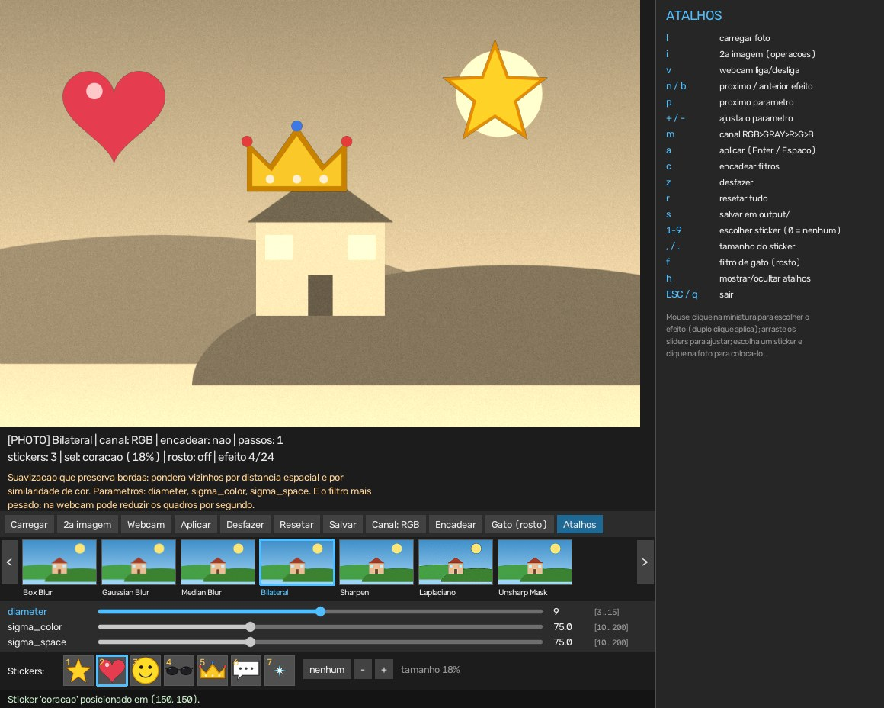

# Editor de Imagens e Vídeo (estilo *stories*)

Trabalho do **Grau B** — *Processamento Gráfico: Fundamentos* (UNISINOS).
Protótipo de aplicativo de edição de imagens e vídeo em **Python + OpenCV**, com foco em
**Processamento de Imagens**: filtros, operações aritméticas entre imagens, seleção de canais
e *stickers*. A interação é feita por **HighGUI (janela do OpenCV) + teclado + console**.



> **Autores:**
> Arthur Rambor
> Gustavo Ribeiro Schwert
> <!-- adicione aqui os demais integrantes do grupo -->

## Requisitos

* Python 3.9 ou mais novo (no Windows, marque *Add Python to PATH* ao instalar)
* Pacotes: `numpy` e `opencv-python` **4.x** (arquivo `requirements.txt`)
* Webcam (somente para o Modo Vídeo) e sistema com interface gráfica

> O `requirements.txt` limita o OpenCV a `<5` de propósito: o pacote `opencv-python` 5.x deixou de
> incluir os classificadores Haar usados no filtro de rosto. Mesmo assim, o projeto traz uma cópia
> do classificador em `assets/` e funciona nas duas versões.

## Instalação e execução

**Windows (PowerShell/CMD):**
```powershell
git clone https://github.com/GustaSch/GrauB_EditorImagens.git
cd GrauB_EditorImagens
python -m venv .venv
.venv\Scripts\activate
pip install -r requirements.txt
python main.py --image assets\samples\exemplo1.jpg
```

**Linux/macOS:**
```bash
git clone https://github.com/GustaSch/GrauB_EditorImagens.git
cd GrauB_EditorImagens
python3 -m venv .venv
source .venv/bin/activate
pip install -r requirements.txt
python main.py --image assets/samples/exemplo1.jpg
```

Outras opções: `python main.py` (editor vazio), `python main.py --camera 1` (outra webcam) e
`python main.py --image foto.jpg --image2 outra.jpg` (já com a 2ª imagem das operações).

## Comandos

| Tecla | Ação |
|---|---|
| `l` | Carregar foto (seletor de arquivos no Windows; nos demais sistemas, digite o caminho no console) |
| `v` | Iniciar / parar a webcam (imagem espelhada) |
| `n` / `b` | Próximo / anterior efeito (mostra **descrição e parâmetros** no console e no painel da janela) |
| `t` | Listar todos os efeitos |
| `p` | Escolher o próximo parâmetro do efeito |
| `+` / `-` | Aumentar / diminuir o parâmetro escolhido |
| `m` | Canal: **RGB → GRAY → R → G → B** |
| `a` (ou Enter / Espaço) | **Aplicar** o efeito selecionado |
| `c` | Alternar **encadeamento** de filtros (um filtro sobre o resultado do anterior) |
| `i` | Carregar a 2ª imagem usada nas operações aritméticas |
| `1`–`9`, `0` | Escolher sticker / nenhum; depois **clique** na foto para posicioná-lo |
| `,` / `.` | Diminuir / aumentar o tamanho do sticker |
| `f` | Filtro de gatinho por **detecção de rosto** (foto e vídeo) |
| `z` | Desfazer a última ação (filtro ou sticker) |
| `s` | **Salvar** a imagem / o quadro atual em `output/` |
| `r` | **Resetar**: remove filtros e stickers, volta à imagem original |
| `h` | Mostrar / ocultar a **legenda de atalhos** (painel à direita da janela) |
| `ESC` ou `q` | Sair |

### Interface na janela (mouse)

Tudo que os atalhos fazem também pode ser feito com o mouse, na própria janela:

| Região | O que faz |
|---|---|
| **Barra de botões** | Carregar, 2ª imagem, Webcam, Aplicar, Desfazer, Resetar, Salvar, Canal, Encadear, Gato (rosto) e Atalhos: repetem as teclas `l i v a z r s m c f h` |
| **Carrossel de filtros** | Miniaturas do efeito aplicado **à sua imagem** (com o canal e os parâmetros atuais). Clique escolhe; **duplo clique aplica**; `<` e `>` rolam a lista. Bolinha verde = efeito já aplicado; `A+B` = operação com duas imagens |
| **Sliders** | Um por parâmetro do efeito: clique ou **arraste** (o valor respeita o passo e os limites). Clicar no nome escolhe o parâmetro para `+`/`-` |
| **Paleta de stickers** | Clique no sticker, depois **clique na foto** para posicioná-lo; `nenhum`, `-` e `+` (tamanho) |
| **Barra de mensagem** | Último aviso do editor (arquivo salvo, erro, etc.) |
| **Legenda (`h`)** | Lista de atalhos sempre à vista |

Fluxo típico: `l` → `n` até o filtro desejado (leia a descrição) → `p`, `+`/`-` para ajustar →
`m` para escolher o canal → `a` para aplicar → `s` para salvar.

## Requisitos do enunciado × onde estão

| Requisito | Situação | Onde |
|---|---|---|
| Modo Foto (carregar imagem do disco) | Atendido | `Editor.load_photo` (`editor.py`), tecla `l` |
| Modo Vídeo (webcam em tempo real) | Atendido | `Editor.toggle_webcam` e `Editor.compose`, tecla `v` |
| Pelo menos 10 filtros | Atendido: **18** filtros | `EFFECTS` em `filters.py` |
| Filtro de suavização / de realce | Atendido | Box, Gaussian, Median, Bilateral / Sharpen, Laplaciano, Unsharp Mask |
| Seleção de canal (RGB, Gray, R, G, B; um canal exibe o resultado daquele canal) | Atendido | `apply_effect` (`filters.py`), tecla `m` |
| Pelo menos 3 operações com duas imagens | Atendido: **6** | `op_add`, `op_subtract`, `op_blend`, `op_multiply`, `op_absdiff`, `op_lighten` |
| Descrição do filtro antes de aplicar | Atendido | `Editor.describe` (console), painel da janela e carrossel (`Editor.render`, `ui.py`) |
| Pelo menos 5 stickers com canal alfa | Atendido: **7** | `assets/stickers/`, `overlay_rgba` em `stickers.py` |
| Posicionar sticker com o clique do mouse (modo foto) | Atendido | `Editor.on_mouse` |
| Salvar e resetar | Atendido | `Editor.save` (tecla `s`) e `Editor.reset` (tecla `r`) |
| Extra: combinação de filtros | Atendido | encadeamento, tecla `c` |
| Extra: sticker animado por spritesheet | Atendido | `7_brilho_f6.png` (6 quadros), `stickers.py` |
| Extra: filtro com detecção de face (Haar) | Atendido | tecla `f`, `Editor._detect_faces` / `draw_cat_face` |
| Extra: interface gráfica com biblioteca externa | Não implementado | a interface é desenhada na janela do OpenCV (HighGUI): botões, carrossel, sliders e paleta em `ui.py`; o seletor de arquivos usa Tkinter (Windows) |

## Efeitos

**Suavização** (4)

| Efeito | O que faz | Parâmetros |
|---|---|---|
| Box Blur | Suavização: substitui cada pixel pela média da vizinhança ksize x ksize. Reduz ruído e detalhes. Parâmetro: ksize (ímpar). | `ksize` (3 a 31, padrão 5) |
| Gaussian Blur | Suavização: média ponderada por uma gaussiana (centro pesa mais que a borda). Parâmetros: ksize (ímpar) e sigma (0 = automático). | `ksize` (3 a 31, padrão 7)<br>`sigma` (0 a 20, padrão 0) |
| Median Blur | Suavização não-linear: usa a mediana da vizinhança. Remove ruído sal-e-pimenta preservando bordas. Parâmetro: ksize (ímpar). | `ksize` (3 a 31, padrão 5) |
| Bilateral | Suavização que preserva bordas: pondera vizinhos por distância espacial e por similaridade de cor. Parâmetros: diameter, sigma_color, sigma_space. É o filtro mais pesado: na webcam pode reduzir os quadros por segundo. | `diameter` (3 a 15, padrão 9)<br>`sigma_color` (10 a 200, padrão 75)<br>`sigma_space` (10 a 200, padrão 75) |

**Realce** (3)

| Efeito | O que faz | Parâmetros |
|---|---|---|
| Sharpen | Realce de nitidez por convolução com kernel [0,-a,0; -a,1+4a,-a; 0,-a,0]. Parâmetro: amount (intensidade a). | `amount` (0.1 a 3, padrão 1) |
| Laplaciano (realce) | Realce pelo operador Laplaciano: saída = imagem - c * Laplaciano(imagem), acentuando transições de intensidade. Parâmetro: strength (c). | `strength` (0.1 a 3, padrão 1) |
| Unsharp Mask | Realce: soma a imagem a diferença entre ela e sua versão borrada (img*(1+k) - blur*k). Parâmetros: ksize do blur e amount (k). | `ksize` (3 a 31, padrão 7)<br>`amount` (0.1 a 5, padrão 1.5) |

**Bordas** (3)

| Efeito | O que faz | Parâmetros |
|---|---|---|
| Sobel (bordas) | Detecção de bordas pelo módulo do gradiente de Sobel (horizontal + vertical). Parâmetro: gain (ganho do resultado). | `gain` (0.2 a 5, padrão 1) |
| Canny (bordas) | Detecção de bordas de Canny (gradiente + supressão de não-máximos + histerese). Parâmetros: limiar baixo e alto. | `low` (0 a 255, padrão 80)<br>`high` (0 a 255, padrão 160) |
| Emboss (relevo) | Efeito de relevo por convolução direcional somada a um deslocamento de 128. Sem parâmetros. | — |

**Cor, tons e histograma** (8)

| Efeito | O que faz | Parâmetros |
|---|---|---|
| Grayscale | Converte para tons de cinza (luminância: 0.299R + 0.587G + 0.114B). Sem parâmetros. | — |
| Negativo | Inverte as intensidades: saída = 255 - entrada. Sem parâmetros. | — |
| Sepia | Tom envelhecido: transformação linear dos canais R,G,B por matriz de sepia. Sem parâmetros. | — |
| Brilho / Contraste | Ajuste linear saída = contraste * entrada + brilho (com saturação em 0..255). Parâmetros: contrast e brightness. | `contrast` (0.2 a 3, padrão 1)<br>`brightness` (-100 a 100, padrão 0) |
| Gamma | Correção gama por tabela (LUT): saída = 255*(entrada/255)^(1/gamma). >1 clareia, <1 escurece. Parâmetro: gamma. | `gamma` (0.2 a 3, padrão 1) |
| Limiarização | Binariza a imagem: pixels acima do limiar viram branco, os demais preto. Parâmetro: level (0-255). | `level` (0 a 255, padrão 127) |
| Equalização de histograma | Redistribui as intensidades para aumentar o contraste global (em cores, equaliza apenas a luminância Y). Sem parâmetros. | — |
| Pixelate | Mosaico: reduz a imagem e amplia com vizinho mais próximo, formando blocos. Parâmetro: block (tamanho do bloco em pixels). | `block` (2 a 60, padrão 10) |

**Operações aritméticas entre duas imagens** (6) — a 2ª imagem é carregada com `i` ou `--image2` (sem ela, usa `assets/samples/exemplo2.jpg`)

| Operação | O que faz | Parâmetros |
|---|---|---|
| Adição (A + w*B) | Operação entre duas imagens: soma saturada A + w*B (clareia). Parâmetro: weight (peso da imagem B). | `weight` (0 a 1, padrão 1) |
| Subtração ponderada (A - w*B) | Operação entre duas imagens: subtração saturada A - w*B (escurece/remove B). Parâmetro: weight (peso da imagem B). | `weight` (0 a 2, padrão 1) |
| Blending (mistura) | Operação entre duas imagens: mistura (1-alpha)*A + alpha*B. Parâmetro: alpha (0 = só A, 1 = só B). | `alpha` (0 a 1, padrão 0.5) |
| Multiplicação (A * B) | Operação entre duas imagens: produto normalizado A*B/255 (escurece, efeito 'multiply'). Sem parâmetros. | — |
| Diferença absoluta \|A - B\| | Operação entre duas imagens: \|A - B\| pixel a pixel (destaca o que mudou). Sem parâmetros. | — |
| Clarear (max(A, B)) | Operação entre duas imagens: máximo pixel a pixel (efeito 'lighten'). Sem parâmetros. | — |

Em todos os efeitos o canal pode ser trocado com `m`. Em **R**, **G** ou **B** o filtro é aplicado só
àquele canal e a janela exibe o resultado dele em tons de cinza.

## Stickers

São 7 stickers em `assets/stickers/` (PNG com canal alfa), selecionados pelas teclas `1` a `7`. O
`brilho` é animado: o arquivo `7_brilho_f6.png` é um *spritesheet* horizontal com 6 quadros
(convenção `nome_fN.png`). Para usar os seus, coloque PNGs com transparência na pasta (até 9 são
selecionáveis, em ordem alfabética). `python generate_assets.py` recria os incluídos, que são
desenhados proceduralmente com OpenCV (sem direitos autorais).

## Estrutura

```
main.py              # ponto de entrada e laço da janela (HighGUI)
editor.py            # estado do editor, pipeline, teclas, mouse, HUD, webcam, rosto
ui.py                # interface na janela: botões, carrossel de miniaturas, sliders, stickers, legenda
filters.py           # filtros, operações aritméticas, descrições e seleção de canal
stickers.py          # carregamento de stickers (alfa), spritesheet e overlay
imageio_utils.py     # leitura/gravação de imagens e redimensionamento
generate_assets.py   # gera stickers (PNG com alfa) e imagens de exemplo
assets/              # stickers, stickers/face (orelhas e focinho), samples e o classificador Haar
docs/                # imagens usadas neste README
tests/test_core.py   # testes automáticos
.github/workflows/   # integração contínua (roda os testes a cada push)
output/              # imagens salvas (conteúdo ignorado pelo git)
```

## Testes

```bash
python -m unittest discover -s tests -v
```

Cobrem todos os efeitos em todos os canais, valores das operações aritméticas, overlay com alfa
e recorte, animação do spritesheet, carregamento do classificador de rosto (inclusive em caminhos
com acentos), pipeline (aplicar, encadear, desfazer, resetar), painel com a descrição do efeito, interface
(cliques em botões, carrossel, sliders arrastáveis, paleta de stickers e miniaturas),
salvamento com caminho acentuado, tratamento de erros (arquivo inexistente, webcam indisponível) e
o laço principal com janela e webcam simuladas. Os mesmos testes rodam no GitHub Actions.

## Créditos

* Stickers e imagens de exemplo: gerados por `generate_assets.py` (autoria do grupo).
* `assets/haarcascade_frontalface_default.xml`: classificador Haar de rosto frontal da
  [OpenCV](https://github.com/opencv/opencv/tree/4.x/data/haarcascades) (Rainer Lienhart; *Intel
  License Agreement*, cujo aviso permanece no próprio arquivo).
